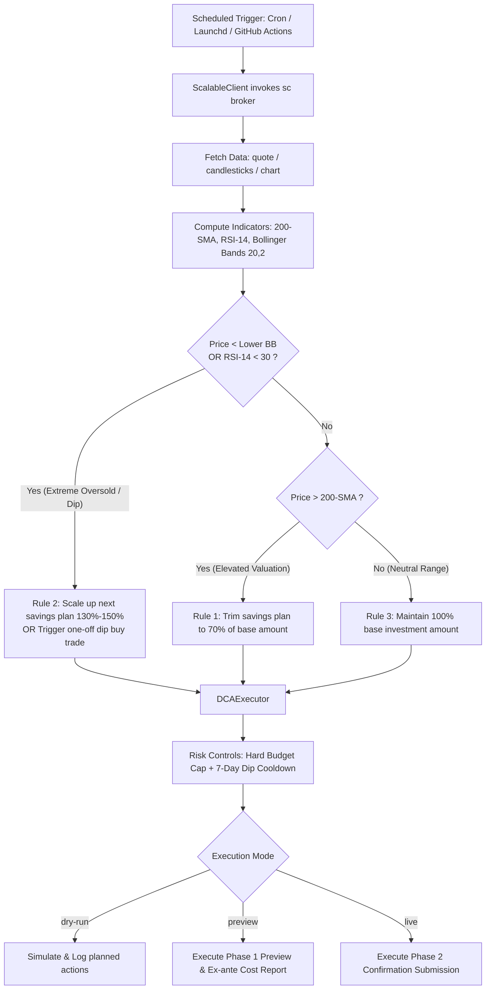

# Smart / Value-Averaging DCA for Scalable Capital

Automated technical-indicator-driven dollar-cost averaging and opportunistic dip buying powered by the official **Scalable Capital CLI (`sc`)**.

[](LICENSE)
[](https://www.python.org/downloads/)
[](https://scalable.capital)

---

## Strategy Philosophy

Traditional **Dollar-Cost Averaging (DCA)** invests a fixed amount regardless of market conditions. In contrast, **Smart / Value-Averaging DCA** dynamically modulates capital allocation based on trend valuation and momentum indicators:



### Core Strategy Rules

1. **High Valuation Defense (Trim on Overvaluation)**:
   - **Condition**: Market price is trading above the 200-day Simple Moving Average ($Price > SMA_{200}$, or 40-week equivalent).
   - **Action**: Lower the target's savings plan to **70% of the base amount** (e.g., €400 $\to$ €280).
   - **Rationale**: Mitigate chasing extended market rallies and preserve cash reserves.

2. **Aggressive Dip Buying (Scale Up on Oversold / Breakdown)**:
   - **Condition**: Market price breaks below the lower Bollinger Band ($Price < Bollinger_{lower}$) **OR** $RSI_{14} < 30$.
   - **Action**:
     - **Dynamic Plan Scaling**: Scale up the upcoming savings plan to **130% ~ 150%** of base.
     - **Opportunistic Buy**: Optionally place an immediate one-off buy trade (`sc broker trade buy`) for fractional or whole shares (with a 7-day cooldown to avoid multi-day crash over-allocation).
   - **Rationale**: Exploit fear-driven selloffs to accumulate shares at discounted valuations.

3. **Neutral Range Reversion**:
   - **Condition**: Price normalizes between the 200-SMA and Bollinger Bands.
   - **Action**: Reset savings plan to **100% of the base amount**.

---

## Key Highlights

- **Zero External Dependencies**: Built with Python 3.11+ standard library (`dataclasses`, `tomllib`, `subprocess`, `math`). No `pip install` required.
- **Two-Phase Safety Guarantee**: Complies strictly with Scalable Capital's two-phase confirmation protocol (Phase 1 preview -> human verification -> Phase 2 execution).
- **Risk Hard Caps & Cooldowns**: Configurable monthly budget limits and dip-buying cooldowns prevent run-away orders.
- **Built-in Backtester**: Easily run simulations comparing Smart DCA vs Vanilla DCA on historical weekly bars.
- **Automated Scheduling**: Ready-to-use templates for GitHub Actions, macOS Launchd, and local Crontab.

---

## Project Structure

```
.
├── smart_dca/
│   ├── __init__.py
│   ├── __main__.py          # Module entrypoint (python3 -m smart_dca)
│   ├── cli.py               # CLI interface (status, run, plans, backtest)
│   ├── client.py            # Scalable CLI (sc) wrapper & JSON parser
│   ├── config.py            # TOML / JSON configuration loader
│   ├── indicators.py        # Technical indicator formulas (SMA, EMA, RSI, Bollinger)
│   ├── strategy.py          # Value-Averaging rule evaluation engine
│   ├── executor.py          # Execution engine with safety caps & state tracking
│   ├── reporter.py          # Terminal visualization dashboard & summaries
│   └── backtest.py          # Historical simulation comparing Smart vs Vanilla DCA
├── config.example.toml      # Documented configuration template
├── run_smart_dca.sh         # Convenient shell wrapper script
├── crontab.example          # Local Cron scheduling example
├── com.scalable.smart_dca.plist # macOS Launchd agent template
├── docs/
│   └── MCP_SETUP.md         # Scalable Capital MCP connection guide
└── .github/workflows/
    └── smart_dca_cron.yml   # GitHub Actions scheduled workflow
```

---

## Quick Start

### 1. Prerequisites

Install the official Scalable Capital CLI (`sc`) and log in:

```bash
# Install via Homebrew (macOS)
brew tap ScalableCapital/tap
brew trust --formula ScalableCapital/tap/scalable-cli
brew install scalable-cli

# Log in
sc login
```

### 2. Configuration Setup

Copy the example configuration file:

```bash
cp config.example.toml config.toml
```

Edit `config.toml` to customize your target assets, base monthly amounts, and risk thresholds.

### 3. Usage & Commands

#### Inspect Market Indicators & Strategy Signals
Inspect current prices, moving averages, RSI, Bollinger Bands, and recommended savings plan amounts without making any broker requests:

```bash
./run_smart_dca.sh status
```

*Terminal Output Example:*
```text
================================================================================
  SCALABLE CAPITAL SMART / VALUE-AVERAGING DCA ENGINE (Mode: DRY-RUN)
================================================================================

  #1  iShares Core S&P 500 (IE00B5BMR087)
      Signal:         [OVERVALUED - TRIM 70%]
      Current Price:  €69.69
      200-SMA:        €65.98 (+5.6%)
      RSI-14:         49.4
      Bollinger (20): [68.35 ~ 72.67]
      Savings Plan:   Current: €400.00  -->  Recommended: €280.00
      Rationale:
        • Price (69.69) is above 200 SMA (65.98, +5.6%)
        • Overvalued: Trimming savings plan from 400.00 to 280.00 (x0.70)
```

#### List Active Savings Plans
Inspect all current savings plans in your Scalable Capital account:

```bash
./run_smart_dca.sh plans
```

#### Simulate Strategy Execution (Dry-Run)
Simulate all rule evaluations and view planned actions:

```bash
./run_smart_dca.sh run --dry-run
```

#### Preview Ex-Ante Costs (Phase 1)
Request pre-trade cost disclosures and generate confirmation tokens without submitting:

```bash
./run_smart_dca.sh run --preview
```

#### Execute Changes (Live Mode)
Confirm and apply plan adjustments or one-off trades:

```bash
./run_smart_dca.sh run --live
```

#### Run Backtest Simulation
Compare historical performance between Smart DCA and standard Vanilla DCA:

```bash
./run_smart_dca.sh backtest
```

---

## Automated Scheduling

### Option A: GitHub Actions (Cloud Cron)
A workflow template is included at `.github/workflows/smart_dca_cron.yml`. It runs automatically every trading day at 08:30 UTC and supports manual dispatch with `dry-run`, `preview`, or `live` modes.

### Option B: macOS Launchd (Recommended for Mac)
Launchd handles sleep and wake intervals gracefully:

```bash
cp com.scalable.smart_dca.plist ~/Library/LaunchAgents/
launchctl load ~/Library/LaunchAgents/com.scalable.smart_dca.plist
```

### Option C: Linux / Local Cron
Add to crontab via `crontab -e`:

```cron
30 8 * * 1-5 cd /path/to/scalable-capital-smart-dca && ./run_smart_dca.sh run --dry-run >> logs/cron.log 2>&1
```

---

## Safety & Risk Controls

1. **Two-Phase Confirmation**: Orders are never placed blindly. Pre-trade disclosures and validation checks precede every execution.
2. **Monthly Budget Hard Cap**: If scaled-up plans exceed `max_monthly_budget`, the executor will reject or cap the order.
3. **Dip-Buying Cooldown**: Prevents consecutive buying during prolonged downtrends (default 7 days).
4. **Credential Isolation**: Account credentials and keychain tokens remain securely within `sc` and the operating system's credential store.

---

## Disclaimer

This software is for educational, research, and algorithmic investment automation purposes only. It is not financial advice. Automated trading and investing carry risk of capital loss. Verify all configurations thoroughly before running in live mode.
