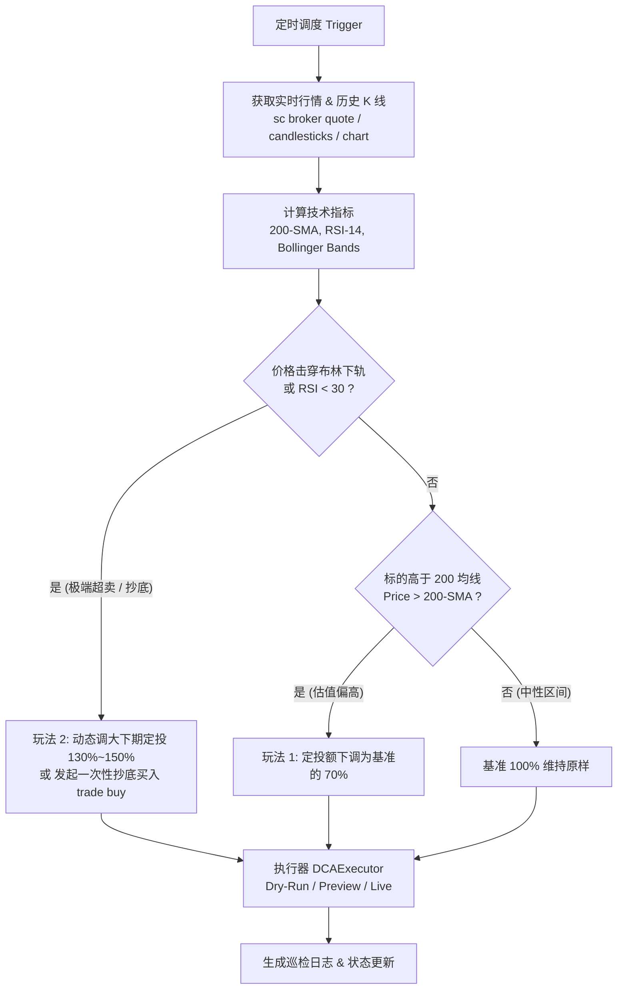

# 智能价值平均定投器 (Smart / Value-Averaging DCA)

基于 **Scalable Capital 官方 CLI (`sc`)** 开发的智能价值平均定投与动态抄底系统。

---

## 核心设计理念

传统的固定金额定投（Vanilla Dollar-Cost Averaging）在任何估值下都投入相同金额。
**智能价值平均定投器 (Smart / Value-Averaging DCA)** 结合了趋势与超卖技术指标：



---

## 核心功能与玩法

### 玩法 1：高位防泡沫减额 (估值偏高)
- **触发条件**：标的价格高于 200 日移动平均线（`Price > 200-SMA`，或行业常用的 40 周均线）。
- **执行动作**：将对应标的的定投计划额度下调为基准额的 **70%**（例如：基准 €400 $\to$ 下调至 €280）。
- **目的**：在市场亢奋、均线上方乖离过大时保留现金弹药。

### 玩法 2：深跌逆向加码抄底 (大跌击穿)
- **触发条件**：标的价格击穿布林带下轨（`Price < Bollinger Lower Band`）**或** 相对强弱指数处于极端超卖状态（`RSI-14 < 30`）。
- **执行动作**：
  1. **动态调大定投**：调用 `sc broker savings-plans add` 调大下期定投金额至基准的 **130% ~ 150%**。
  2. **一次性加仓买入**：通过 `sc broker trade buy` 发起单笔即时加仓抄底买入（自带 $\ge 1$ 股整股金额校验与 7 天冷却防踩踏机制）。
- **目的**：利用恐惧区间的非理性抛售，以更低成本快速积累份额。

### 玩法 3：中性区间回归
- **触发条件**：处于布林带与 200 均线正常回撤区间。
- **执行动作**：定投额度恢复为 **100% 基准额度**。

---

## 项目结构

```
scalable.capital/
├── smart_dca/
│   ├── __init__.py
│   ├── __main__.py          # 模块执行入口 (python3 -m smart_dca)
│   ├── cli.py               # 命令行交互工具 (status, run, plans, backtest)
│   ├── client.py            # Scalable CLI (sc) 封装库，处理 JSON 与异常
│   ├── config.py            # 零外部依赖配置加载器 (TOML / JSON / YAML)
│   ├── indicators.py        # 纯 Python 技术指标库 (SMA, EMA, RSI, Bollinger Bands)
│   ├── strategy.py          # 策略判断引擎与决策生成
│   ├── executor.py          # 包含两阶段安全确认、风控限额与冷却机制的执行器
│   ├── reporter.py          # 终端彩色可视化看板与格式化报告
│   └── backtest.py          # 历史数据回测仿真器 (对比 Smart DCA vs Standard DCA)
├── config.toml              # 策略配置文件（监控标的、基准金额、触发阈值）
├── run_smart_dca.sh         # 一键运行与调度包装脚本
├── crontab.example          # 本地 Cron 调度示例
├── com.scalable.smart_dca.plist # macOS 原生 Launchd 调度配置
└── .github/workflows/
    └── smart_dca_cron.yml   # GitHub Actions 定时调度工作流
```

---

## 快速上手

### 1. 查看监控标的技术指标与决策看板
无需做任何改动，立即查询当前标的的指标状态与策略建议：
```bash
./run_smart_dca.sh status
```

输出示例：
```text
================================================================================
  SCALABLE CAPITAL SMART / VALUE-AVERAGING DCA ENGINE (Mode: DRY-RUN)
================================================================================

  #1  Amundi Core S&P 500 (LU0496786574)
      Signal:         [OVERVALUED - TRIM 70%]
      Current Price:  €69.69
      200-SMA:        €65.98 (+5.6%)
      RSI-14:         49.4
      Bollinger (20): [68.35 ~ 72.67]
      Savings Plan:   Current: €400.00  -->  Recommended: €280.00
      Rationale:
        • Price (69.69) is above 200 SMA (65.98, +5.6%)
        • Overvalued: Trimming savings plan from 400.00 to 280.00 (x0.70)
```

### 2. 查看当前账户所有在跑的定投计划
```bash
./run_smart_dca.sh plans
```

### 3. 运行策略评估 (模拟执行)
```bash
./run_smart_dca.sh run --dry-run
```

### 4. 预检模式 (Phase 1 Preview)
调用 Scalable 官方预检，拉取真实的事前成本报告 (Ex-ante costs) 与确认 ID，**但不真实扣款提交**：
```bash
./run_smart_dca.sh run --preview
```

### 5. 正式执行模式 (Live Mode)
确认指标与配置无误后，正式生效并向 Scalable Capital 提交修改或买入：
```bash
./run_smart_dca.sh run --live
```

### 6. 运行历史数据回测
测试过去 1 年历史数据下，智能定投相比机械定投的成本优势：
```bash
./run_smart_dca.sh backtest
```

---

## 配置说明 (`config.toml`)

你可以随时在 `config.toml` 中添加或调整任意 ETF 或股票标的：

```toml
[app]
mode = "dry-run" # "dry-run" (模拟), "preview" (预检), "live" (真实执行)

[safety]
max_monthly_budget = 2500.0            # 全账户每月定投硬上限 (€)
max_single_trade_amount = 500.0        # 单次抄底加仓最大金额 (€)
opportunistic_buy_cooldown_days = 7    # 抄底冷却期 (天)

[[targets]]
isin = "LU0496786574"                  # 标的 ISIN
name = "Amundi Core S&P 500"
base_amount = 400.0                    # 基准月定投额 (€400)
execution_day_of_month = 10            # 扣款日

[targets.overvalued_rule]
enabled = true
sma_period = 200
amount_multiplier = 0.70               # 高于 200 均线时降至 70%

[targets.oversold_rule]
enabled = true
rsi_threshold = 30.0                   # RSI < 30
bollinger_period = 20
bollinger_std = 2.0
action_type = "scale_up_savings_plan"  # 调大下期定投
savings_plan_multiplier = 1.30         # 调大至 130% (€520)
trade_buy_amount = 100.0               # 单笔抄底买入额 (€)
```

---

## 自动化定时调度方案

### 方案 A：macOS 原生后台调度 (推荐，支持盒盖唤醒补跑)
将自带的 `com.scalable.smart_dca.plist` 放入用户 LaunchAgents 目录：
```bash
cp com.scalable.smart_dca.plist ~/Library/LaunchAgents/
launchctl load ~/Library/LaunchAgents/com.scalable.smart_dca.plist
```

### 方案 B：Linux / macOS Crontab
编辑定时任务：
```bash
crontab -e
```
添加（每个交易日盘前 08:30 自动巡检）：
```cron
30 8 * * 1-5 cd /Users/chair_kao/Antigravity/scalable-capital-smart-dca && ./run_smart_dca.sh run >> logs/cron.log 2>&1
```

### 方案 C：GitHub Actions 云端定时任务
代码仓库已包含 [smart_dca_cron.yml](file:///.github/workflows/smart_dca_cron.yml)：
1. 支持定时调度（每周一至周五 08:30 UTC）。
2. 支持 GitHub 网页上手动点击 `workflow_dispatch`，自由选择 `dry-run`、`preview` 或 `live` 触发。

---

## 安全风控机制

1. **两阶段显式确认 (Two-Phase Commitment)**：
   - Scalable CLI 原生强制要求 Phase 1（事前信息披露预检）和 Phase 2（`--confirm <id>` 提交）。本工具严格遵守该规范，在 `dry-run` 和 `preview` 模式下绝不调用 Phase 2。
2. **预算硬顶 (Hard Cap)**：
   - 策略计算得到的额度若突破全局 `max_monthly_budget` 或 `max_single_trade_amount`，执行器会自动拦截。
3. **抄底冷却防踩踏 (Dip Cooldown)**：
   - 当大盘单边持续暴跌时，避免程序每日连续发出抄底买入指令，默认设置 7 天冷却期。
4. **零外部强依赖**：
   - 核心代码基于 Python 3.11+ 标准库编写，无需复杂包安装，开箱即用。
